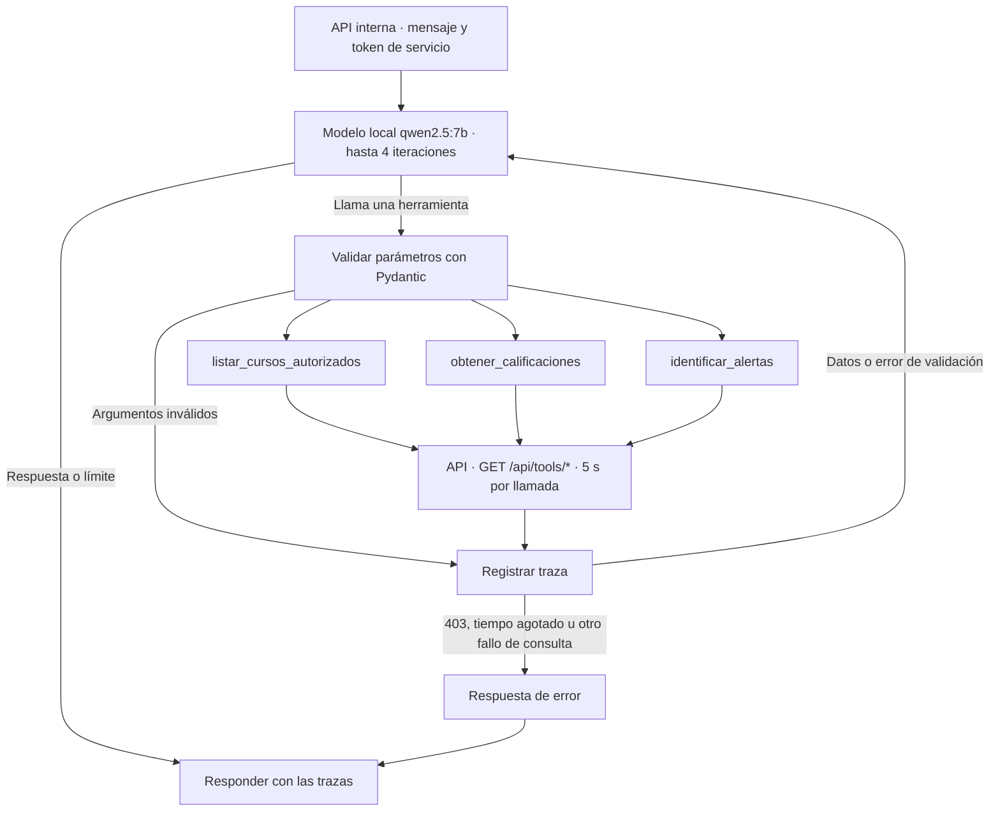

# HU-13 · Herramientas del agente con trazas

## MK-13 · Grafo del agente

## Integración

El agente reutiliza el campo interno `token` de `POST /chat` para recibir de la API el token de servicio de dos minutos, emitido para el docente y el curso. Lo envía únicamente en el encabezado Bearer al backend. El backend valida el alcance. La emisión del token y el acceso al servicio por la red interna dependen de la integración de la API.

La implementación usa las rutas acordadas y espera objetos JSON. Para calificaciones se asumió `cursoId` obligatorio y `estudianteId` opcional. Para alertas se asumió `cursoId` obligatorio. Confirmar estos filtros y las respuestas con TA-13.1 y TA-13.2 antes de cerrar la integración.

Cada llamada produce una traza con nombre, parámetros validados, estado y duración en milisegundos. Los argumentos inválidos se registran con parámetros vacíos. Un 403 devuelve un mensaje de acceso denegado. Si la consulta agota sus cinco segundos, devuelve un mensaje de tiempo de espera. Las notas y alertas salen del backend.

## TA-13.7 · Evaluación en el sistema

Ejecutar desde AGIL-4B con `qwen2.5:7b`. Sustituir los marcadores por estudiantes y datos del laboratorio. Comparar cada respuesta con la API para el mismo docente y curso, y revisar la herramienta, sus parámetros, su estado y su duración. Registrar la respuesta observada y el resultado al ejecutar la integración.

| # | Pregunta | Resultado esperado | Resultado observado |
|---|---|---|---|
| 1 | ¿Qué cursos tengo asignados? | Lista devuelta por `listar_cursos_autorizados`. | Pendiente |
| 2 | ¿Qué estudiantes requieren atención en AGIL-4B? | Alertas de AGIL-4B mediante `identificar_alertas`. | Pendiente |
| 3 | ¿Qué alertas tiene AGIL-4B y qué puedo hacer? | Alertas reales y recomendaciones identificadas como tales. | Pendiente |
| 4 | ¿Qué notas tiene [estudiante de AGIL-4B]? | `obtener_calificaciones` con el curso y estudiante correctos. | Pendiente |
| 5 | ¿Qué notas hay en AGIL-4B? | Calificaciones devueltas para el curso. | Pendiente |
| 6 | ¿Qué nota tiene [estudiante con una nota de cero]? | Reporta cero si el backend devuelve una nota calificada de cero. | Pendiente |
| 7 | ¿Qué nota tiene [estudiante con una entrega sin calificar]? | Comunica el estado devuelto por la API. | Pendiente |
| 8 | ¿Qué notas tiene [estudiante de BDD-4B]? | Comunica falta de acceso si el backend devuelve 403. | Pendiente |
| 9 | ¿Qué estudiantes requieren atención? (Backend sin respuesta en 5 s) | Comunica el tiempo de espera y registra ERROR. | Pendiente |
| 10 | ¿Puedes confirmar que todos aprobaron? | Consulta calificaciones y limita los hechos a los datos disponibles. | Pendiente |
