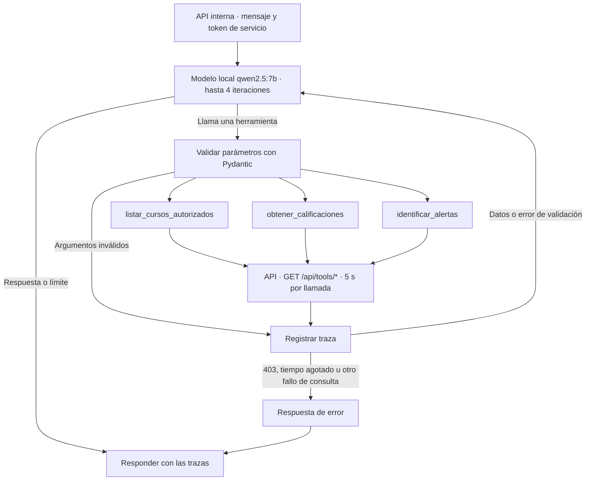

# HU-13 · Herramientas del agente con trazas

## Evidencias en la aplicación

Capturas de la aplicación en Docker (`http://localhost:5173`) del 11 nov 2026, entre las 21:45 y las 21:50, con doc01 en AGIL-4B, sección «Asistente». Modelo `qwen2.5:7b`.

Los criterios salen de la planificación del Sprint 1 (RF-13, Tabla 9 criterios 5 y 7) y del contrato de las herramientas del Sprint 2. La redacción oficial en Jira queda por confirmar.

| Criterio | Captura | Dato observado |
|---|---|---|
| CA-1 · DADO un curso sincronizado, CUANDO el docente pregunta por datos, ENTONCES el agente llama a la herramienta, responde con datos reales y muestra la traza (nombre, parámetros, estado y duración) | [CA-1_herramienta-con-datos-reales-y-traza.png](CA-1_herramienta-con-datos-reales-y-traza.png) | «¿Quiénes tienen promedio bajo 7?» en 16 s: los 9 estudiantes bajo 7, de María Naranjo (3,42) a Olga Paredes (6,97), iguales al panel; `obtener_calificaciones`, `cursoId=1`, OK |
| CA-2 · DADO una herramienta que falla, ENTONCES el agente dice qué no pudo consultar y no inventa datos | [CA-2_herramienta-falla-sin-inventar-datos.png](CA-2_herramienta-falla-sin-inventar-datos.png) | «¿Qué estudiantes requieren atención?»: `identificar_alertas` con ERROR, porque `GET /api/tools/alertas` (TA-13.2) espera HU-12; respuesta «No pude consultar los datos académicos en este momento.» |
| CA-3 · DADO un curso de otro docente, CUANDO la herramienta responde 403, ENTONCES el agente dice que no tiene acceso | [CA-3_curso-ajeno-sin-acceso.png](CA-3_curso-ajeno-sin-acceso.png) | «Consulta las calificaciones del curso con cursoId 2.»: `obtener_calificaciones`, `cursoId=2`, ERROR; respuesta «No tienes acceso a ese curso.» |

La herramienta `obtener_calificaciones` devuelve un resumen por estudiante sin `estudianteId` y el detalle por actividad con él (#28). Las secciones siguientes son la documentación del agente de Jeremy, movida desde `agent/docs/hu-13.md`.

## MK-13 · Grafo del agente

## Integración

El agente reutiliza el campo interno `token` de `POST /chat` para recibir de la API el token de servicio de dos minutos, emitido para el docente y el curso. Lo envía únicamente en el encabezado Bearer al backend. El backend valida el alcance. La emisión del token y el acceso al servicio por la red interna dependen de la integración de la API.

La implementación usa las rutas acordadas y espera objetos JSON. Para calificaciones se asumió `cursoId` obligatorio y `estudianteId` opcional. Para alertas se asumió `cursoId` obligatorio. Confirmar estos filtros y las respuestas con TA-13.1 y TA-13.2 antes de cerrar la integración.

Cada llamada produce una traza con nombre, parámetros validados, estado y duración en milisegundos. Los argumentos inválidos se registran con parámetros vacíos. Un 403 devuelve un mensaje de acceso denegado. Si la consulta agota sus cinco segundos, devuelve un mensaje de tiempo de espera. Las notas y alertas salen del backend.

## TA-13.7 · Evaluación en el sistema

Ejecutada por Kevin el 12 nov 2026, de 07:47 a 07:52, con 10 preguntas contra el asistente real (doc01, AGIL-4B, `qwen2.5:7b`). Tabla completa, respuestas observadas y diferencias con la API en [evaluacion.md](evaluacion.md).

- Herramienta correcta en 10 de 10.
- Respuestas: 5 correctas, 2 parciales y 3 incorrectas.
- Ningún dato inventado.
- 15,4 s en promedio.

Las fallas aparecen cuando el modelo tiene que filtrar u ordenar la lista de 32 estudiantes. Las preguntas cambiaron frente a la tabla propuesta por Jeremy en #21: se ajustaron a la distribución que pidió Kevin y a la búsqueda por nombre (#37).
